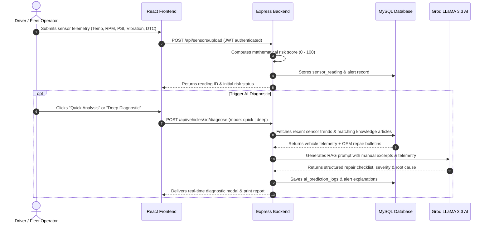

# AutoGuard AI — Technical Documentation & Architecture Manual

> **Predictive Fleet Telemetry & Generative RAG Diagnostic Platform**  
> Built with Node.js Express, MySQL, React (Vite), and Groq LLaMA 3.3 70B Versatile.

---

## 1. Executive Summary & Purpose

Modern commercial and personal vehicle fleets operate in high-risk operational environments where unexpected mechanical breakdowns cause severe financial loss, safety hazards, and delivery delays.

**AutoGuard AI** is an end-to-end predictive vehicle health platform designed to transform traditional **reactive maintenance** (servicing after a component breaks down) into **predictive, condition-based maintenance** (diagnosing micro-anomalies before catastrophic mechanical failure).

The application streams continuous high-frequency IoT sensor telemetry—including **engine temperature, oil pressure, engine RPM, vibration harmonics, and OBD-II Diagnostic Trouble Codes (DTCs)**—and pairs it with **Retrieval-Augmented Generation (RAG)** grounded in verified Original Equipment Manufacturer (OEM) service manuals.

---

## 2. Which Problems Does It Solve?

### Problem 1: Unplanned Fleet Downtime & Costly Breakdowns
* **Industry Reality**: A single catastrophic engine or transmission failure on a commercial truck or delivery van costs upwards of \$8,000 to \$15,000 in repairs, towing, and lost revenue.
* **AutoGuard AI Solution**: Continuous anomaly detection monitors sensor variances (e.g. slight oil pressure drop or engine mount vibration increase) and alerts operators before mechanical failure occurs.

### Problem 2: LLM Hallucinations in Technical Diagnostics
* **Industry Reality**: Standard AI chatbots frequently hallucinate vehicle repair instructions, confusing torque specifications, wiring diagrams, and critical diagnostic steps.
* **AutoGuard AI Solution**: Implements **Retrieval-Augmented Generation (RAG)**. Every diagnostic inference query pulls verified technical service bulletins and repair manuals directly from the MySQL knowledge base, grounding the Groq LLaMA 3.3 response in manufacturer-verified procedures.

### Problem 3: Disconnected Fleet Workflows
* **Industry Reality**: Telemetry systems, repair workshops, and driver logs typically live in fragmented silos.
* **AutoGuard AI Solution**: Provides an all-in-one platform integrating:
  1. Live Telemetry HUD stations with real-time Chart.js sensor timelines.
  2. Dual-mode AI diagnostics (Instant Triage vs. Deep Multi-step Root Cause).
  3. Integrated maintenance work orders with one-click repair tracking.
  4. Multi-role Access Control (Admin, Engineer, Driver).

---

## 3. System Architecture & Tech Stack

```
   ┌─────────────────────────────────────────────────────────┐
   │                   React 18 SPA (Vite)                   │
   │  - React Router DOM 6        - React Bits <Radar />      │
   │  - Light / Dark Mode         - Chart.js Telemetry HUD    │
   │  - Animated Counters         - Glassmorphic Bento Cards  │
   └──────────────────────────┬──────────────────────────────┘
                              │ REST / JSON (Axios + JWT)
                              ▼
   ┌─────────────────────────────────────────────────────────┐
   │                  Node.js / Express.js                   │
   │  - ES Modules (ESM)          - BCrypt Password Hashing  │
   │  - JWT Auth Middleware       - Background IoT Simulator │
   │  - Role Authorization (RBAC) - CORS Security Config     │
   └───────────────┬─────────────────────────┬───────────────┘
                   │                         │
     SQL Queries   ▼                         ▼   RAG Grounding
   ┌───────────────────────┐       ┌─────────────────────────┐
   │      MySQL Database   │       │  Groq Cloud LLaMA 3.3   │
   │  - Connection Pool    │       │  - 70B Versatile Model  │
   │  - Parametric Queries │       │  - Sub-200ms Inference │
   │  - Relational FKs     │       │  - Vector/Keyword RAG   │
   └───────────────────────┘       └─────────────────────────┘
```

### Technology Highlights:
- **Frontend**: React 18, Vite, Bootstrap 5.3 + Custom Aceternity-inspired CSS, Bootstrap Icons, Chart.js, React Bits WebGL `<Radar />` shader.
- **Backend**: Node.js (v18+), Express (v4), ES Modules, `mysql2/promise` with connection pooling, `jsonwebtoken`, `bcryptjs`, `dotenv`.
- **Database**: MySQL 8.0 with InnoDB foreign key constraints, automated seeding and upsert migrations.
- **AI / LLM**: Groq Cloud API running `llama-3.3-70b-versatile` with automated fallback to mathematical fault prediction when no API key is supplied.

---

## 4. Complete Application Workflow



---

## 5. Core Feature Catalog

### 1. High-Tech Aceternity Hero & WebGL Radar
- Full-bleed edge-to-edge landing page with WebGL `<Radar />` component from React Bits.
- Dynamic color adaptation for **Dark Mode** (`#38bdf8`) and **Light Mode** (`#0284c7`).
- Animated stat counters displaying fleet scale (`14,800+` monitored vehicles, `99.98%` capture rate, `180ms` latency).
- Glassmorphic floating Telemetry HUD showcasing live simulated sensor metrics.

### 2. Interactive Anomaly Risk Playground
- Real-time client-side sensor sliders for Engine Temperature, Oil Pressure, RPM, and Vibration.
- Presets for **Nominal Operating Condition**, **Low Oil Pressure Warning**, and **Critical Thermal Failure**.
- Instant color-coded severity indicator (Low, Medium, High) and fault signature prediction.

### 3. Fleet Garage Management
- Grid and Table view modes with instant search by vehicle name, make, model, or VIN.
- Filter by risk level (High, Medium, Low).
- Spec chips displaying vehicle mileage, engine type, model year, and active diagnostic status.
- Zero-clutter cards with guaranteed readability in both Light and Dark modes.

### 4. Vehicle Command HUD Station
- Interactive telemetry timeline charts powered by Chart.js for all four critical sensor channels.
- Dual-mode AI diagnostic buttons:
  - **Quick AI Analysis**: Fast roadside triage summary.
  - **Deep Diagnostic**: Multi-step OEM repair checklist citing root causes and service bulletins.
- Anomaly injector toolbar allowing operators to simulate live sensor packets or generate 20 historical readings on demand.
- Integrated maintenance work orders with one-click "Mark Completed" tracking.

### 5. Automated 30-Second IoT Simulator
- Background daemon simulating high-frequency telemetry ingestion across all active fleet vehicles.
- Toggle on/off directly from the Command Center header.

### 6. Admin Control Center
- RAG Knowledge Base management: create, edit, and delete technical service manuals.
- User Role Management: update user roles between `DRIVER`, `ENGINEER`, and `ADMIN`.
- System AI Request Audit Logs: view full prompt logs, token counts, and latency statistics.

### 7. Universal Light & Dark Mode
- Smooth one-click toggle in the desktop and mobile navigation bars.
- Automatically saves preference to `localStorage` and detects OS `prefers-color-scheme`.
- Seamlessly themes all cards, headers, tables, modal dialogs, and the WebGL Radar.

### 8. Zero-Scroll Modern Auth Pages
- Viewport-fit layout (`100vh`) eliminating annoying vertical scrollbars on laptops.
- One-click demo credentials autofill buttons for Admin, Engineer, and Driver.

---

## 6. Database Entities & Schema

| Table Name | Description | Key Relationships |
|---|---|---|
| `users` | Fleet operator accounts, password hashes, and RBAC roles | Primary auth table |
| `vehicles` | Vehicles in the fleet with specs, VIN, and owner assignment | `user_id -> users(id)` |
| `sensor_readings` | High-frequency telemetry packets (RPM, temp, PSI, vibration, DTC) | `vehicle_id -> vehicles(id)` |
| `alerts` | Fault alerts and calculated risk scores (0 to 100) | `vehicle_id -> vehicles(id)` |
| `alert_explanations` | Explanations and AI diagnostic findings linked to alerts | `alert_id -> alerts(id)` |
| `maintenance_records` | Scheduled and completed repair work orders | `vehicle_id -> vehicles(id)` |
| `knowledge_articles` | OEM service manuals and DTC procedures for RAG grounding | Indexed for search |
| `ai_prediction_logs` | Audit trail of all AI diagnostic inferences with latency metrics | `vehicle_id -> vehicles(id)` |

---

## 7. REST API Endpoints Reference

### Authentication (`/api/auth`)
- `POST /api/auth/register` — Create a new fleet operator account.
- `POST /api/auth/login` — Authenticate and receive stateless JWT token.
- `GET /api/auth/me` — Retrieve authenticated user profile and role.

### Fleet Operations (`/api/vehicles`)
- `GET /api/vehicles` — List vehicles (filtered by user ownership or team view).
- `POST /api/vehicles` — Register a new vehicle with initial sensor seed.
- `GET /api/vehicles/:id` — Vehicle detail with recent readings and alerts.
- `PUT /api/vehicles/:id` — Update vehicle specs or mileage.
- `DELETE /api/vehicles/:id` — Delete vehicle and cascade all telemetry.
- `POST /api/vehicles/:id/diagnose` — Trigger Groq LLaMA 3.3 RAG diagnostic.
- `POST /api/vehicles/:id/simulate` — Ingest 1 simulated sensor reading.
- `POST /api/vehicles/:id/simulate/history` — Seed 20 historical readings.

### Sensor Telemetry (`/api/sensors`)
- `POST /api/sensors/upload` — Manually log field-calibrated sensor data.
- `GET /api/sensors/vehicle/:vehicleId/history` — Fetch historical telemetry stream.

### Charts & Analytics (`/api/charts`)
- `GET /api/charts/vehicle/:id/sensors` — Formatted dataset for Chart.js HUD.

### Simulator (`/api/simulator`)
- `GET /api/simulator/status` — Current status of 30-second automated telemetry stream.
- `POST /api/simulator/toggle` — Start or pause background telemetry simulator.

### Admin Operations (`/api/admin`)
- `GET /api/admin/panel` — System overview with articles, users, and audit logs.
- `POST /api/admin/knowledge` — Add new OEM technical service manual.
- `DELETE /api/admin/knowledge/:id` — Remove knowledge article.
- `POST /api/admin/users/:id/role` — Update user authorization role (`ADMIN`, `ENGINEER`, `DRIVER`).

---

## 8. Demo Credentials & How to Run

### Verified Demo Accounts
| Role | Email | Password |
|---|---|---|
| **Administrator** | `admin@autoguard.ai` (or `admin@autoguard.com`) | `Password@1234` |
| **Fleet Engineer** | `engineer@autoguard.ai` | `Password@1234` |
| **Driver / Owner** | `driver@autoguard.ai` | `Password@1234` |

### Starting the Application

1. **Start the Backend**:
   ```bash
   cd backend
   npm run dev
   ```
   *Runs on `http://localhost:5000` (ES modules, connected to MySQL `autoguard_db`).*

2. **Start the Frontend**:
   ```bash
   cd frontend
   npm run dev
   ```
   *Runs on `http://localhost:5173` with Vite HMR.*

3. **Production Build**:
   ```bash
   cd frontend
   npm run build
   ```
   *Compiles all JSX, WebGL shaders, and CSS into optimized static assets.*
