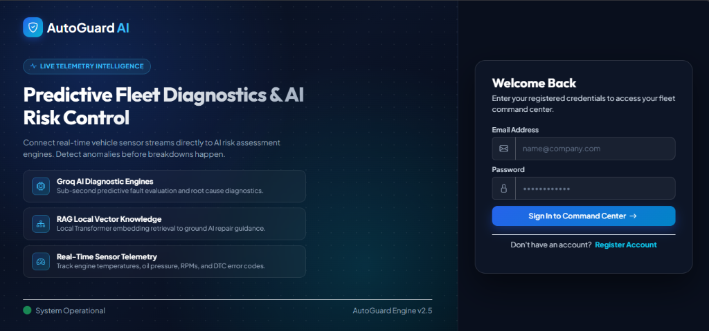
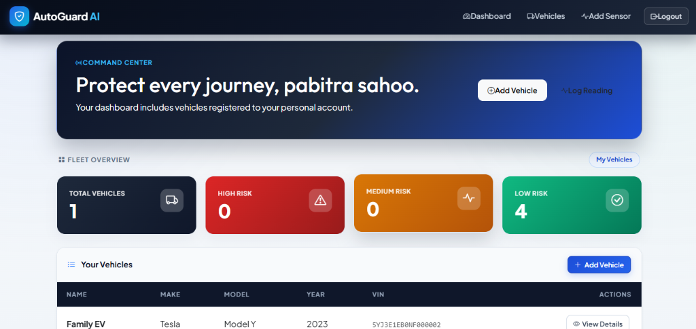
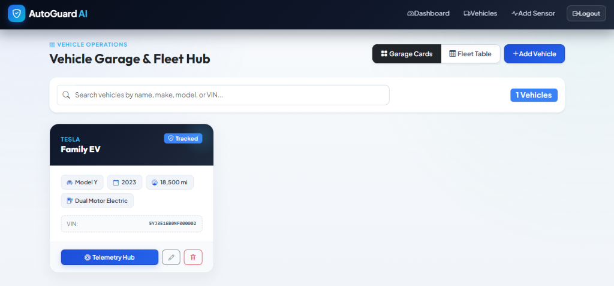
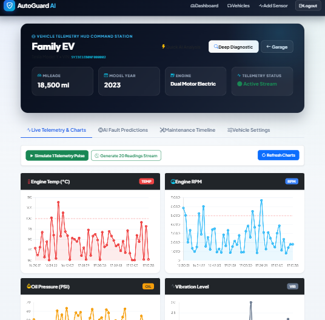

# AutoGuard AI — Intelligent Predictive Fleet Maintenance Platform

AutoGuard AI is an enterprise-grade vehicle fleet monitoring and predictive diagnostic platform. It connects real-time IoT vehicle telemetry streams—including Engine RPM, Temperature, Oil Pressure, Vibration indices, and Diagnostic Trouble Codes (DTCs)—with generative AI models and Retrieval-Augmented Generation (RAG).

By continuously analyzing raw sensor data against operational anomaly thresholds and vector-indexed service manuals, AutoGuard AI enables vehicle owners, service technicians, and fleet administrators to transition from costly reactive breakdowns to proactive predictive care.

> 📄 **Technical Reference**: For exhaustive architectural specifications, technology breakdown, and data isolation models, see [PROJECT_DETAILS.md](PROJECT_DETAILS.md).

---

## 📸 Interface & Command Deck Showcase

### 1. Split-Screen High-Tech Authentication
High-contrast `100vh` viewport-fitted authentication experience featuring real-time feature showcases and modern frosted glass form containers.


---

### 2. Fleet Overview Command Center
Centralized dashboard providing real-time fleet risk distribution counters (High, Medium, Low Risk), registered vehicle metrics, and instant navigation.


---

### 3. Interactive Vehicle Garage & Fleet Hub
Garage card grid system with real-time client-side search filtering by vehicle name, make, model, or VIN, plus view-switching between card grid and tabular fleet layouts.


---

### 4. Telemetry HUD Command Station & Dynamic Analytics
Vehicle command deck equipped with spec badges, dual AI analysis triggers (`QUICK` vs `DEEP`), and live Chart.js sensor telemetry charts highlighting operational danger thresholds.


---

## 🎯 What AutoGuard AI Solves

1. **Eliminates Reactive Breakdown Costs**: Replaces traditional "wait until it breaks" repair workflows with automated threshold monitoring and early fault prediction.
2. **Translates Raw Telemetry into Clear Action**: Converts complex sensor metrics (RPM, temperature, oil pressure, vibration) into readable operational risk scores ($0 - 100$) and plain-English repair steps.
3. **Grounded AI via Local RAG**: Utilizes local HuggingFace ONNX Transformer embeddings and vector search to ground Groq AI recommendations in actual technical bulletins, preventing AI hallucinations.
4. **Multi-Tenant Security & Scoped Access**: Enforces strict role-based data isolation so vehicle owners access only their registered assets while fleet engineers and admins manage fleet-wide operations.

---

## ⚡ Core Platform Capabilities

- **IoT Telemetry Ingestion & Simulation**: Streams continuous vehicle sensor parameters and flags anomalies (Engine Temp $>100^\circ\text{C}$, Oil Pressure $<20\text{ PSI}$, Vibration $>1.0$, DTC codes).
- **Dual-Mode AI Risk Assessment**:
  - **Quick AI Analysis (`QUICK`)**: Fast operational health summaries and immediate risk scoring.
  - **Deep Diagnostic (`DEEP`)**: Exhaustive root-cause reports powered by RAG similarity retrieval across vector-indexed service manuals.
- **Dynamic Telemetry Visualization**: Interactive Chart.js line charts tracking historical trends for Engine Temperature, RPM, Oil Pressure, and Vibration.
- **Complete Maintenance Timeline**: Comprehensive service logging tied directly to vehicle fault predictions and AI diagnostics.
- **Admin Control Center**: Centralized administration panel for user role management, system audit logs, and technical knowledge base authoring.

---

## 🛠️ Technology Stack Breakdown

| Layer | Technology & Frameworks |
| :--- | :--- |
| **Backend Core** | Java 21 (LTS), Spring Boot 3.4.4, Spring MVC, Spring Data JPA, Hibernate 6.6 |
| **Security & Auth** | Spring Security 6, BCrypt Password Hashing, CSRF Protection, Role-Based Access Control (`OWNER`, `ENGINEER`, `ADMIN`) |
| **Database** | MySQL 8.0, HikariCP JDBC Connection Pool |
| **AI Integration** | Spring AI (1.0.0-M6), Groq API (`openai/gpt-oss-20b`) |
| **RAG & Embeddings** | Spring AI Transformers (ONNX model), Local JVM Embeddings, In-Memory Vector Store |
| **Frontend & Design** | Server-Side Thymeleaf 3, Bootstrap 5.3, Bootstrap Icons, Chart.js 4.4, Custom Vanilla CSS (`app.css`) |
| **Typography** | Google Fonts (**Plus Jakarta Sans**, **Outfit**) |
| **Build & Tooling** | Apache Maven |

---

## 🚀 Quick Start (Run Locally)

### Prerequisites
- **Java 21 JDK** installed.
- **MySQL 8.0** server running locally on port `3306`.
- **Groq API Key** (for AI diagnostic generation).

### 1. Database Creation
Create the MySQL database named `autoguard_db`:
```sql
CREATE DATABASE autoguard_db CHARACTER SET utf8mb4 COLLATE utf8mb4_unicode_ci;
```

### 2. Environment Setup
Copy `.env.example` to `.env` in the project root and set your MySQL credentials and Groq API key:
```properties
AUTOGUARD_DB_URL=jdbc:mysql://localhost:3306/autoguard_db?useSSL=false&serverTimezone=UTC&allowPublicKeyRetrieval=true
AUTOGUARD_DB_USERNAME=root
AUTOGUARD_DB_PASSWORD=your_mysql_password
AUTOGUARD_GROQ_API_KEY=your_groq_api_key
```

### 3. Launch Application
Build and launch the Spring Boot server:
```bash
./mvnw.cmd spring-boot:run
```
*(On Linux/macOS: `./mvnw spring-boot:run`)*

### 4. Access Web Interface
Open **[http://localhost:7070/auth/login](http://localhost:7070/auth/login)** in your browser, register a new account, and sign in to access your fleet command center!

---

## 🔒 Security & Data Privacy

- **Protected Secrets**: Credentials and API keys are stored exclusively in ignored `.env` files and environment variables.
- **Strict Data Scoping**: Vehicle routes enforce user-level ownership checks; `OWNER` users can never access unassigned fleet assets.
- **CSRF & Password Policies**: State-mutating HTTP methods verify CSRF tokens. User registration enforces a 10+ character policy with uppercase, lowercase, and numeric validation.

---

## 📄 Documentation Links

- [PROJECT_DETAILS.md](PROJECT_DETAILS.md): Comprehensive architectural problem statement, technology stack breakdown, and reliability specifications.
